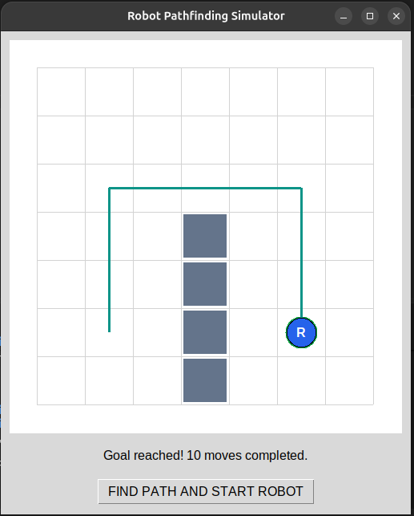

# 🤖 Autonomous Robot Pathfinding Simulator

**Project 01 | Robotics Engineering Portfolio**

**Developed by:** Saad Toor  
**GitHub:** [@saadtoorx](https://github.com/saadtoorx)  
**Field:** Robotics Engineering | Autonomous Systems | Path Planning

---

## 📌 Project Overview

The Autonomous Robot Pathfinding Simulator is a Python-based educational robotics project that demonstrates fundamental concepts of robot navigation, motion control, coordinate systems, and obstacle-aware path planning.

The project was developed progressively, starting from basic robot position tracking and advancing to automatic route execution and shortest-path planning using Breadth-First Search (BFS).

This project is part of my robotics engineering learning journey, focusing on developing practical skills in autonomous systems, robotics software, and artificial intelligence.

## 🖥️ Project Demonstration

## 🚀 Features

- Basic robot position simulation
- Interactive 2D graphical robot movement
- Manual robot control using keyboard and buttons
- Automated movement along predefined routes
- Real-time visualization of robot trajectories
- Obstacle-aware pathfinding using BFS
- Shortest-path calculation on a grid with equal movement costs
- Detection of unreachable destinations
- CSV movement history logging
- Automated testing of the pathfinding algorithm

## 🛠️ Technologies Used

| Technology | Purpose |
|---|---|
| Python | Main programming language |
| Tkinter | Graphical user interface |
| Breadth-First Search | Shortest-path planning |
| Collections / deque | Efficient BFS queue |
| CSV | Robot movement logging |
| unittest | Automated algorithm testing |
| Git & GitHub | Version control and documentation |
| Ubuntu Linux | Development environment |

## 📂 Project Structure

- `robot.py` — Basic robot movement
- `robot_2d.py` — Interactive 2D robot simulator
- `robot_auto.py` — Automatic movement and trajectory tracking
- `robot_pathfinding.py` — Graphical autonomous pathfinding simulator
- `pathfinding_core.py` — Reusable BFS pathfinding algorithm
- `test_pathfinding.py` — Automated algorithm tests
- `robot_path.csv` — Recorded movement history
- `pathfinding_results.csv` — Pathfinding movement history
- `screenshots/pathfinding.png` — Project demonstration screenshot

## ⚙️ Installation and Usage

**1. Install Python and Tkinter on Ubuntu:**

`sudo apt update`

`sudo apt install python3 python3-tk`

**2. Open the project directory.**

**3. Run the autonomous pathfinding simulator:**

`python3 robot_pathfinding.py`

**4. Click "FIND PATH AND START ROBOT" to begin the simulation.**

## 🧠 How the Algorithm Works

The environment is represented as a 7 × 7 grid containing free cells and obstacles.

The robot starts at `(1, 1)` and attempts to reach `(5, 1)`.

A vertical wall blocks the direct route, requiring the robot to find an alternative path.

The Breadth-First Search algorithm:

1. Begins at the starting position.
2. Explores neighboring cells in four directions.
3. Rejects obstacles and out-of-bounds positions.
4. Records previously visited positions.
5. Reconstructs a shortest valid route upon reaching the goal.
6. Returns no path when the destination is unreachable.

For the default environment, the calculated route requires **14 movements**.

## 🧪 Automated Testing

The project includes automated tests for:

- Finding the expected shortest path
- Avoiding obstacles
- Ensuring valid movement between neighboring cells
- Detecting unreachable destinations
- Handling identical starting and destination positions
- Rejecting invalid destinations

Run tests using:

`python3 -m unittest -v`

## 📚 Learning Outcomes

Through this project, I developed practical understanding of:

- Python programming for robotics
- Robot coordinate systems
- Graphical robotics simulation
- Automatic movement execution
- Grid-based environment representation
- Pathfinding algorithms
- Software modularity
- Unit testing
- Robot trajectory visualization
- Engineering documentation and version control

## ⚠️ Project Limitations

This is an educational grid-based robotics simulator, not a full physics-based robotic system.

The current implementation assumes that obstacle locations are known in advance and that movement between neighboring cells has equal cost.

The simulator does not yet include physical robot dynamics, real-world sensor feedback, or continuous motion control.

## 🔮 Future Improvements

- A* pathfinding implementation
- Interactive obstacle placement
- Robot orientation and continuous movement
- Simulated sensor feedback
- Dynamic obstacle avoidance
- ROS 2 integration
- Real robot hardware implementation

---

## 👨‍💻 About the Developer

**Saad Toor**

**GitHub:** [github.com/saadtoorx](https://github.com/saadtoorx)

---

*Part of my hands-on Robotics Engineering Portfolio — progressing from foundational robotics programming toward advanced autonomous and AI-powered robotic systems.*